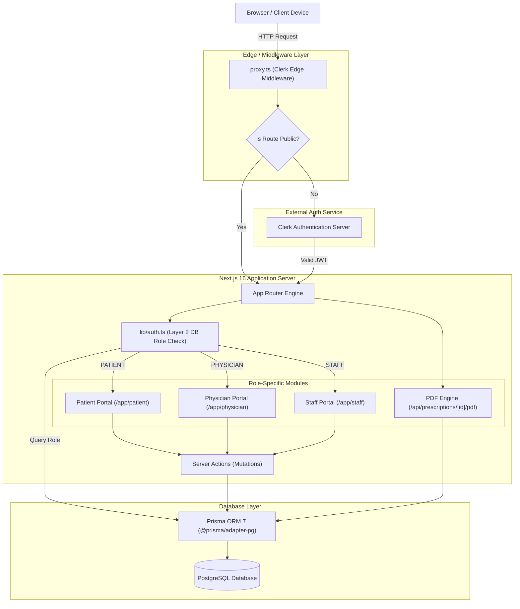
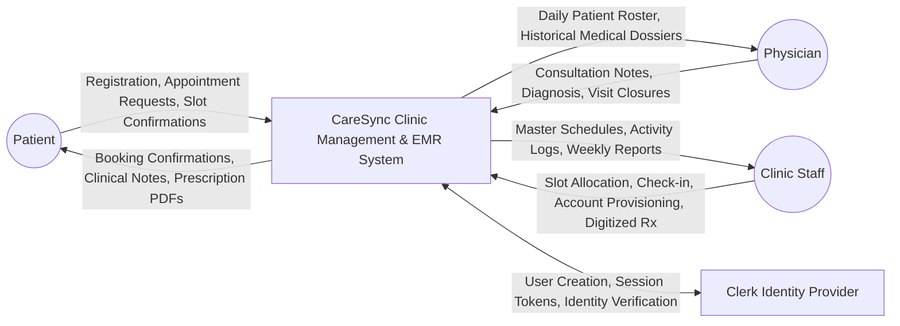
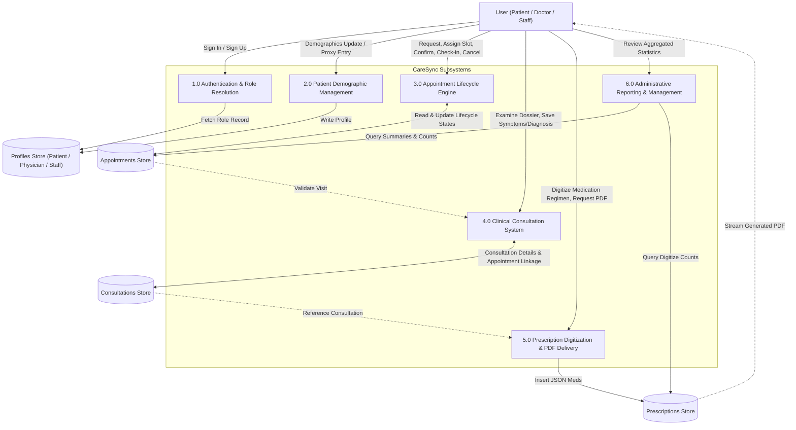
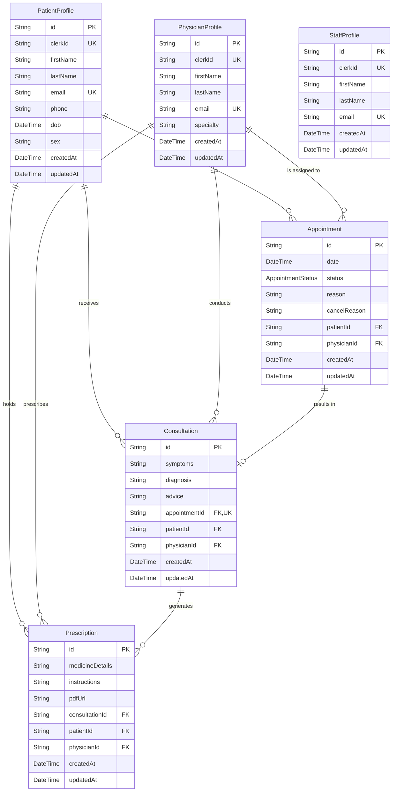

# CARESYNC — COMPLETE PROJECT ANALYSIS & ACADEMIC DOCUMENTATION

---

## 1. EXECUTIVE PROJECT OVERVIEW

### 1.1 What is CareSync?
**CareSync** (internally identified in the repository configuration as `sure_care` and branded across the user interface as **CareClinic**) is a multi-tenant, role-based Clinic Management and Electronic Medical Records (EMR) web application. It is engineered using **Next.js 16 (App Router)**, **React 19**, **Prisma ORM 7**, **PostgreSQL**, and **Clerk Identity**.

The system coordinates clinical operations across three primary user roles:
1. **Patients**: Self-register, request appointments, review and confirm assigned time slots, view consultation summaries, and download generated official prescription PDFs.
2. **Physicians**: Review the day's scheduled patient roster, examine complete clinical histories, record diagnostic consultation notes (symptoms, diagnosis, medical advice), and close or cancel visits.
3. **Clinic Staff / Reception**: Manage master daily appointment rosters, assign scheduling slots to pending requests, handle walk-in/proxy registrations and bookings, perform desk check-ins and mark no-shows, digitize handwritten paper prescriptions into structured medication regimens, monitor weekly administrative reporting metrics, and provision clinician/staff accounts.

---

### 1.2 Problem Statement & Justification
Traditional outpatient clinics and small-to-medium healthcare facilities face several logistical challenges:
* **The "Phone-Tag" Scheduling Bottleneck**: Patients calling reception back and forth to find available slots results in scheduling conflicts, unrecorded cancellations, and administrative overload.
* **Fragmented and Misplaced Clinical Histories**: When patient histories are stored across physical paper files or disjointed spreadsheets, doctors lack immediate access to previous diagnoses and prescriptions during active consultations.
* **Illegible Handwritten Prescriptions**: Paper prescription slips are prone to misinterpretation by patients and pharmacists, posing patient safety risks and medication errors.
* **Loose Coordination Between Front-Desk and Consulting Rooms**: Reception staff often cannot see whether a consultation is underway, completed, or delayed without physical interruption, while physicians lack real-time visibility into who is currently seated in the waiting room.

---

### 1.3 Core Working Philosophy & Key Innovations
* **Single Patient Record Across All Touchpoints**: One unified record is shared by reception, physicians, and patients, ensuring data consistency across all clinical touchpoints.
* **Asymmetric Asynchronous Booking Model**: Instead of letting patients blindly book arbitrary calendar slots that conflict with clinical capacity, patients submit appointment requests describing their medical reasons. Staff assign an appropriate doctor and time slot based on actual clinic capacity, and the patient confirms or cancels the assigned slot.
* **Separation of Clinical vs. Administrative Data**: Reception staff can see appointment operational metadata and timestamps but cannot view confidential diagnostic notes. Only the attending physician and the patient can access clinical notes (implementing the healthcare principle of **Least Privilege** and the **Minimum Necessary Rule**).
* **Two-Stage Prescription Digitization**: Acknowledging that doctors frequently write quick physical slips during consultations, staff enter handwritten prescription details into a structured data template (`name`, `dosage`, `frequency`, `timing`, `duration`). An automated PDF rendering engine generates formal, standardized prescription documents for download and printing.

---

## 2. TECHNOLOGY STACK ANALYSIS

| Technology Layer | Tool / Library | Version | Role in CareSync | Architectural Justification |
| :--- | :--- | :--- | :--- | :--- |
| **Full-Stack Framework** | Next.js | `16.3.4` (App Router) | Core application framework | Provides Server Components (RSC), Server Actions for mutations, unified API route handlers, and streaming SSR. |
| **UI Library** | React | `19.2.8` | Client and Server Component rendering | Enables hooks like `useActionState`, `useFormStatus`, and native asynchronous server transitions. |
| **Authentication & Identity** | @clerk/nextjs | `^7.9.1` | Identity management & session handling | Manages authentication, multi-factor auth, session cookies, and user lifecycle. |
| **Database & ORM** | Prisma ORM | `^7.10.0` | Object-Relational Mapping & Database Schema | Type-safe database queries, schema migrations, and client generation. |
| **Driver Adapter** | @prisma/adapter-pg | `^7.10.0` | PostgreSQL connection pooling | Required by Prisma 7 to handle standard PostgreSQL connections via native pg pool. |
| **Database Engine** | PostgreSQL | Compatible with PG 14+ | Relational data persistence | ACID-compliant storage for profiles, appointments, consultations, and prescriptions. |
| **PDF Generation Engine**| pdf-lib | `^1.17.1` | Programmatic vector PDF compilation | Generates printable A4 medical prescriptions on-the-fly without requiring headless Chrome or external microservices. |
| **CSS Styling Engine** | Tailwind CSS | `^4.0.0` + PostCSS | Utility-first styling & design system | Custom tokens, responsive CSS grids, CSS variables, dark/light contrast tokens. |
| **UI Icons** | lucide-react | `^1.42.0` | Visual icon indicators | Consistent vector icons across portal navigation, toolbar actions, and status indicators. |
| **Headless UI Primitives**| @base-ui/react & Native Dialog | `^1.8.0` / HTML5 | Accessible slide-overs and drawers | Native `<dialog>` elements for accessible focus trapping, escape-to-close behavior. |
| **Development Execution**| tsx | `^4.23.13` | TypeScript execution environment | Runs database query verification, seeding, and administrative CLI bootstrap scripts directly. |

---

## 3. COMPLETE FEATURE SPECIFICATION & VERIFICATION

| Feature ID & Name | Primary User | Access Path | Processing Logic & Data Flow | Database Mutations | Implementation Status |
| :--- | :--- | :--- | :--- | :--- | :--- |
| **F-01: Patient Self-Registration** | Patient | `/sign-up` → `/complete-registration` | User registers via Clerk (email/password or Google). Redirects to `/complete-registration` where demographics are collected. Prevents duplicate registrations. | Inserts into `PatientProfile` with Clerk ID link. | **Fully Implemented** |
| **F-02: Role Routing Callback** | All Roles | `/auth-callback` | Reads database profiles matching `auth().userId`. Redirects to respective portal (`/patient/dashboard`, `/physician/dashboard`, `/staff/dashboard`). Flags uncompleted sign-ups. | None (Read queries across all 3 profile tables). | **Fully Implemented** |
| **F-03: Consultation Request** | Patient | `/patient/appointments` | Patient inputs clinical reason. System checks for open appointments; prevents submitting multiple concurrent requests. | Inserts into `Appointment` (`status = PENDING`, `date = null`). | **Fully Implemented** |
| **F-04: Slot Assignment** | Staff | `/staff/dashboard` or `/staff/schedule` | Staff picks a pending request, selects a physician and date/time. Status changes from `PENDING` to `SCHEDULED`. | Updates `Appointment` (`status = SCHEDULED`, sets `date`, `physicianId`). | **Fully Implemented** |
| **F-05: Patient Slot Acceptance** | Patient | `/patient/appointments` | Patient reviews assigned time. Clicking "Accept" confirms their attendance. | Updates `Appointment` (`status = ACCEPTED`). | **Fully Implemented** |
| **F-06: Appointment Cancellation** | Patient / Doctor / Staff | Respective portals | Mandatory reason text required (minimum 4 characters). Prevents cancellation of already closed or completed visits. | Updates `Appointment` (`status = CANCELLED`, sets `cancelReason`). | **Fully Implemented** |
| **F-07: Front-Desk Desk Check-In** | Staff | `/staff/dashboard` | Staff clicks "Check in" upon patient arrival. Indicates the patient is now in the waiting room. | Updates `Appointment` (`status = CHECKED_IN`). | **Fully Implemented** |
| **F-08: Mark No-Show** | Staff | `/staff/schedule` | Staff marks patient absent if appointment window lapses without arrival. | Updates `Appointment` (`status = NO_SHOW`). | **Fully Implemented** |
| **F-09: Consultation Note Writing** | Physician | `/physician/consultation/[id]` | Attending physician inputs symptoms, diagnosis, and medical advice. Prevents unauthorized physicians from editing. | Inserts or updates `Consultation` entity. | **Fully Implemented** |
| **F-10: Visit Completion** | Physician | `/physician/consultation/[id]` | Doctor completes the consultation. Validates that a consultation note exists before allowing status to change. | Updates `Appointment` (`status = COMPLETED`). | **Fully Implemented** |
| **F-11: Prescription Digitization** | Staff | `/staff/prescriptions` | Staff enters handwritten prescriptions into a dynamic multi-line form. Serializes lines to JSON. | Inserts into `Prescription` linked to `Consultation`. | **Fully Implemented** |
| **F-12: Prescription PDF Engine** | Patient / Staff / Doctor | `/api/prescriptions/[id]/pdf` | Generates A4 PDF using `pdf-lib`. Enforces role-based access before streaming document. | None (Reads `Prescription`, `PatientProfile`, `PhysicianProfile`). | **Fully Implemented** |
| **F-13: Walk-in Proxy Registration** | Staff | `/staff/patients` | Staff registers walk-in patients without Clerk interaction. Sets placeholder `clerkId: "proxy:<email>"`. | Inserts into `PatientProfile`. | **Fully Implemented** |
| **F-14: Walk-in Direct Booking** | Staff | `/staff/schedule` | Staff books an appointment immediately for a registered patient. Status set directly to `ACCEPTED`. | Inserts into `Appointment` (`status = ACCEPTED`). | **Fully Implemented** |
| **F-15: Weekly Activity Reports** | Staff | `/staff/reports` | Calculates weekly volume, completed visits, digitised prescriptions, and daily workload distribution. | Aggregate queries (`count`, `groupBy`). | **Fully Implemented** |
| **F-16: Staff & Physician Provisioning** | Staff | `/staff/accounts` | Staff generates credentials for doctors or colleagues via Clerk Backend SDK and creates profile row. | Calls Clerk API, inserts into `PhysicianProfile` or `StaffProfile`. | **Fully Implemented** |

---

## 4. SYSTEM ARCHITECTURE & DATA FLOW

### 4.1 System Architecture
CareSync employs a two-tier edge-to-serverless architectural pattern:
1. **Edge Protection (Layer 1)**: `proxy.ts` filters requests via Clerk edge middleware. Public routes (`/`, `/sign-in`, `/sign-up`, `/auth-error`) are allowed; protected routes require an active Clerk JWT.
2. **Database-Driven Role Authorization (Layer 2)**: `lib/auth.ts` intercepts requests in Server Components and Server Actions, resolving the user's role from database tables (`PatientProfile`, `PhysicianProfile`, `StaffProfile`).
3. **Optimistic Locking Mutations**: Server Actions update records with strict `where` clauses matching expected statuses to prevent concurrent modification conflicts.

---

### 4.2 Data Flow Diagrams

#### DFD Level 0 (Context Diagram)

#### DFD Level 1 (Decomposition Diagram)

---

## 5. DATABASE SCHEMA & RELATIONAL ARCHITECTURE

---

## 6. TESTING, SECURITY & QUALITY ANALYSIS

### 6.1 Testing Verification Matrix

| Test Case ID | Target Feature / Module | Test Scenario & Verification Step | Expected Result | Evidence / Implementation Basis | Status |
| :--- | :--- | :--- | :--- | :--- | :--- |
| **TC-01** | Database Layer Query Execution | Run `scripts/verify-queries.ts` to exercise all model queries. | Queries execute against database schema without type mismatches. | `scripts/verify-queries.ts` exercises all Prisma model operations with temporary tagged records. | **Verified via Script** |
| **TC-02** | Layer-2 Role Access Control | Invoke `authorize("STAFF")` from a non-staff session. | Throws `Error("FORBIDDEN")` and blocks execution. | Implemented in `lib/auth.ts#L104-L117` and verified in server actions. | **Code Verified** |
| **TC-03** | Single Open Appointment Rule | Patient submits a second consultation request while one is active. | Server action rejects with error: `"You already have an open appointment"`. | Implemented in `app/patient/actions.ts#L27-L32`. | **Code Verified** |
| **TC-04** | Consultation Completion Check | Physician attempts to mark an appointment complete without saving notes. | Rejects with message: `"Write the consultation note before completing the visit."` | Implemented in `app/physician/actions.ts#L102-L104`. | **Code Verified** |
| **TC-05** | Prescription PDF Permissions | Patient attempts to download another patient's prescription PDF by ID. | Responds with HTTP `404 Not Found`. | Implemented in `app/api/prescriptions/[id]/pdf/route.ts#L35-L41`. | **Code Verified** |
| **TC-06** | Demographic Boundary Check | Patient registers with a birth date set in the future. | Rejected with message: `"Date of birth cannot be in the future."` | Implemented in `app/complete-registration/actions.ts#L42-L44`. | **Code Verified** |
| **TC-07** | Staff Account Provisioning | Staff provisions a user with a password under 15 characters. | Action rejects with error citing instance minimum password length. | Implemented in `app/staff/accounts/actions.ts#L65-L69`. | **Code Verified** |

---

## 7. FINAL PRESENTATION (PPT) SLIDE OUTLINE

* **Slide 1: Title**: CareSync — Clinic Management & Electronic Medical Records (Next.js 16, React 19, Prisma 7, PostgreSQL, Clerk).
* **Slide 2: Problem Statement**: Phone scheduling conflicts, uncoordinated waiting rooms, lost paper histories, and illegible handwriting.
* **Slide 3: Project Objectives**: Unified patient records, asynchronous booking pipeline, role-based data minimization, structured prescription digitization.
* **Slide 4: Technology Stack**: Next.js 16 App Router, React 19 RSCs, Tailwind CSS v4, Prisma ORM 7, PostgreSQL, pdf-lib.
* **Slide 5: System Architecture & Security**: Two-layer security (Edge Clerk session check + Layer-2 PostgreSQL role check), unforgeable permissions.
* **Slide 6: Database Design**: Six relational models (`PatientProfile`, `PhysicianProfile`, `StaffProfile`, `Appointment`, `Consultation`, `Prescription`).
* **Slide 7: Appointment Lifecycle Engine**: `PENDING` → `SCHEDULED` → `ACCEPTED` → `CHECKED_IN` → `COMPLETED` pipeline.
* **Slide 8: Patient Experience**: Online self-registration, single-click consultation requests, time confirmation, prescription PDF downloads.
* **Slide 9: Physician Clinical Workspace**: Live daily patient roster, instant historical dossiers, clinical notes form, completion verification.
* **Slide 10: Front-Desk Operational Hub**: Master schedule calendar, waiting room check-in, walk-in proxy registration/booking, weekly report metrics.
* **Slide 11: Prescription Digitization Desk**: Front-desk transcribes doctor notes into structured fields; generates A4 vector PDFs via `pdf-lib`.
* **Slide 12: Testing & Verification**: Automated query test suite (`scripts/verify-queries.ts`), boundary validation, IDOR protection.
* **Slide 13: Project Limitations & Future Scope**: Currently optimized for outpatient clinics; future scope includes lab equipment integration and SMS alerts.
* **Slide 14: Conclusion & Live Demonstration**: Complete digital replacement for fragmented clinic paperwork with strong patient privacy protections.

---

## 8. VIVA PREPARATION QUESTIONS & ACCURATE ANSWERS

1. **What is CareSync?** A multi-role Clinic Management and Electronic Medical Records web application unifying outpatient workflows across patients, physicians, and clinic staff.
2. **Why was Next.js 16 selected?** Next.js App Router provides full-stack capabilities in one project, leveraging Server Components for fast data rendering and Server Actions for secure mutations.
3. **How does CareSync prevent client-side privilege escalation?** Roles are determined directly from PostgreSQL database records (`PatientProfile`, `PhysicianProfile`, `StaffProfile`) on the server rather than client-writable JWT claims.
4. **Explain the two-layer security architecture.** Layer 1 is Clerk edge middleware verifying active sessions; Layer 2 is database-backed role authorization inside `lib/auth.ts`.
5. **What is the difference between `requireRole` and `authorize`?** `requireRole` is used in Server Components and redirects unauthorized users; `authorize` is used in Server Actions and API routes, throwing errors to fail mutations safely.
6. **Why are Patient, Physician, and Staff separate tables?** Each role has unique domain attributes (e.g., doctor specialty, patient demographics) and distinct access boundaries.
7. **Explain the appointment status progression.** `PENDING` (requested) → `SCHEDULED` (slot assigned) → `ACCEPTED` (patient confirmed) → `CHECKED_IN` (arrived) → `COMPLETED` (visit concluded).
8. **What does `@prisma/adapter-pg` do?** Prisma 7 requires driver adapters to handle PostgreSQL connection pooling efficiently.
9. **How are race conditions prevented during status updates?** Server actions use conditional queries matching both ID and current status, preventing concurrent conflicting updates.
10. **Why can patients only have one active appointment?** To prevent queue abuse and duplicate bookings, ensuring fair access to clinic capacity.
11. **Why does CareSync use asynchronous scheduling instead of direct calendar booking?** Direct booking frequently creates scheduling conflicts with real-world doctor availability; request-and-assign ensures balanced, accurate clinic schedules.
12. **How are walk-in patients handled?** Staff can register walk-ins by proxy with temporary placeholder IDs (`proxy:<email>`) and book visits immediately.
13. **How is the healthcare "Minimum Necessary" privacy principle applied?** Staff can see appointment schedules and arrival statuses, but confidential diagnostic notes remain restricted to doctors and patients.
14. **How does the system prevent premature visit completion?** The `markCompleted` action enforces that a consultation note exists before allowing completion.
15. **How does prescription digitization work?** Staff transcribe handwritten prescriptions into a structured multi-line form, which is stored as structured JSON and rendered into an official PDF.
16. **How are prescription PDFs generated?** Built on-demand using `pdf-lib` in `/api/prescriptions/[id]/pdf` and streamed directly to the browser.
17. **How is IDOR prevented during PDF downloads?** The route handler confirms the requester is clinic staff, the prescribing doctor, or the patient named on the prescription before serving the file.
18. **What does `scripts/bootstrap-staff.ts` do?** Creates the very first administrative staff account via CLI, since staff accounts can otherwise only be created by existing staff.
19. **How was query reliability verified?** Through `scripts/verify-queries.ts`, which runs every Prisma query used across the portal against the database using temporary records.
20. **How are slide-over drawers built?** Using a reusable `Sheet` component wrapping the native HTML5 `<dialog>` element for accessible focus trapping and modal behavior.
21. **How are fonts configured?** Via `next/font/google` in `app/layout.tsx` using Inter (interface), Instrument Serif (headings), and IBM Plex Mono (clinical data).
22. **What happens if an existing patient registers again?** Detected at `/auth-callback` and redirected to `/auth-error?reason=account-exists` with a prompt to sign in instead.
23. **How does staff provision doctor accounts?** Through `/staff/accounts` using the Clerk Backend SDK with enforced minimum password length (15 characters).
24. **What database constraints protect against duplicate user profiles?** Unique constraints on `clerkId` and `email` across all three profile tables.
25. **Why are Server Actions used instead of REST endpoints for mutations?** They run exclusively on the server, eliminate API boilerplate, integrate cleanly with React 19's `useActionState`, and automatically revalidate cache paths.
26. **What is stored in `Prescription.medicineDetails`?** A JSON array of structured medication objects (`name`, `dosage`, `frequency`, `timing`, `duration`).
27. **What happens if a patient does not arrive for a visit?** Staff mark the appointment as `NO_SHOW`, concluding the visit without completing a consultation note.
28. **How does the weekly report calculate busiest days?** Queries weekly appointments grouped by day, dynamically scaling day bars relative to the busiest day.
29. **Why is `proxy.ts` noted in the codebase?** It houses the Clerk edge route matcher; renaming or aliasing it to `middleware.ts` aligns with standard Next.js conventions.
30. **What are the top future scope additions?** Laboratory diagnostic integrations, automated SMS/email alerts, and multi-tenant clinic partitioning.
